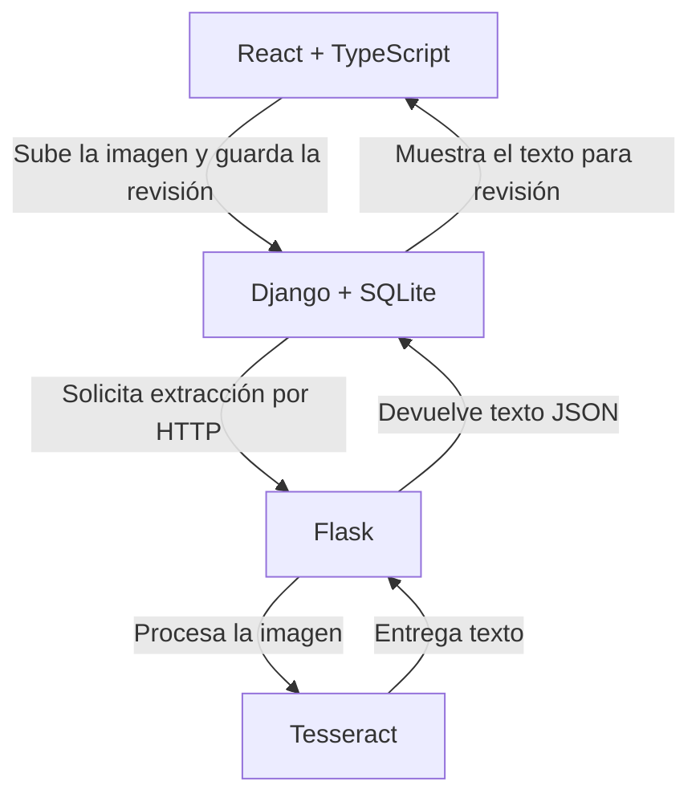

# Optical Flow

Demo independiente para digitalizar y revisar documentos de una óptica. El proyecto procesa imágenes ficticias y se ejecuta localmente.

## Ejecución local

Necesitas Git, Docker con Compose v2 (incluido en Docker Desktop), el motor de Docker activo y el puerto 5173 disponible. La primera compilación descarga las imágenes y las dependencias de los tres servicios.

```sh
git clone https://github.com/CAMIZOCA/optical-flow.git
cd optical-flow
docker compose up --build
```

Si ya tienes el código, ejecuta `docker compose up --build` desde la carpeta que contiene `compose.yaml`. Cuando arranque la interfaz, abre [http://127.0.0.1:5173](http://127.0.0.1:5173).

### Prueba rápida

1. Pulsa **Probar con un ejemplo** o sube un JPEG o PNG ficticio de hasta 8 MB y 20 megapíxeles.
2. Espera el OCR, corrige el texto si hace falta y escribe la referencia ficticia `DEMO-001`.
3. Pulsa **Aprobar captura** y descarga la imagen original.
4. Recarga la página para confirmar que se conserva la revisión.

Si el OCR falla, pulsa **Ejecutar OCR** en el detalle de la captura para reintentar.

### Diagnóstico y apagado

```sh
docker compose ps
docker compose logs --tail=100 web api ocr
```

Con los servicios en marcha, comprueba Django y compila la interfaz con estos comandos.

```sh
docker compose exec -T api python manage.py check
docker compose exec -T api python manage.py migrate --check
docker compose exec -T web npm run build
```

Para apagar la demo, pulsa **Ctrl+C** en la terminal donde ejecutaste Compose y luego usa `docker compose down`. El volumen `captures` conserva la base SQLite y las imágenes originales. `docker compose down --volumes` elimina ese volumen y sus datos.

## Arquitectura



- **React y TypeScript** permiten cargar la imagen, comparar el original con el texto, corregirlo y aprobar la captura. Vite y Node.js sirven la interfaz y enrutan las llamadas a Django.
- **Django y Python** validan JPEG/PNG, registran cada captura y guardan su estado, la transcripción y la referencia ficticia.
- **Flask y Python** exponen el OCR como servicio HTTP. **Tesseract** extrae el texto con el modelo de español. El motor tiene un límite de tiempo y el panel permite reintentar fallos.
- **Docker Compose** reúne la interfaz (`web/`), la API de capturas (`api/`) y el OCR (`ocr/`) en una red interna. Solo publica la interfaz en la dirección de loopback. Vite redirige las solicitudes a `/api/` hacia Django.

## Alcance y siguientes etapas

### Prototipo Expo para Android e iOS

En `mobile/` hay una app Expo para capturar fotos consecutivas sin cerrar la cámara, importar varias imágenes, guardar el original junto con un JPEG optimizado y una miniatura, procesar el OCR de forma secuencial y revisar nombre y cédula en campos separados. Cada foto lleva su estado y un historial de cambios guardados en SQLite del dispositivo. [Instrucciones móviles](mobile/README.md), [plan de trabajo](docs/PLAN_DE_TRABAJO.md), [arquitectura](docs/ARQUITECTURA.md) y [contrato futuro de Laravel](docs/API_CONTRACT.md).

La API OCR para pruebas móviles se activa con `compose.mobile.yaml` y un token. La vinculación a pacientes de Óptica Andina pertenece a la siguiente fase.

La demo funciona localmente con datos sintéticos y carece de cuentas de usuario. Usa la imagen ficticia de `web/public/sample.png` para compartir ejemplos. El [plan de mejoras](docs/plan-de-mejoras.md) organiza las actividades por prioridad e incluye criterios para validar cada etapa, desde las pruebas del flujo actual hasta las integraciones con Android y Laravel.

## Descripción para portafolio

> Optical Flow — Prototipo de digitalización de expedientes en React y TypeScript, con una API en Django, un servicio de OCR en Flask y Tesseract, y ejecución local con Docker Compose. Incluye revisión manual del texto y aprobación de capturas.
