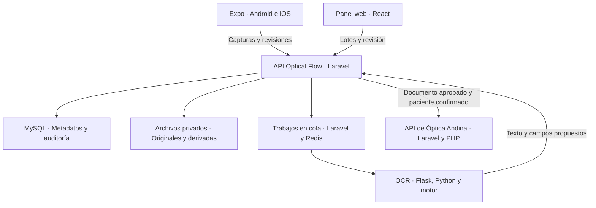
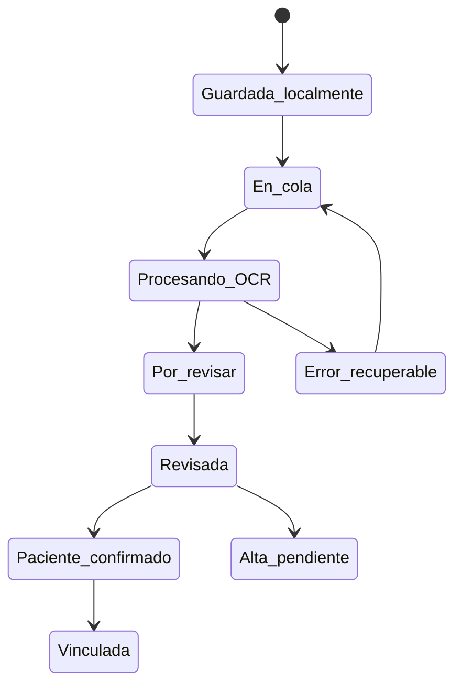

# Arquitectura de Optical Flow

Documento de diseño · 11 de noviembre de 2026

## Componentes y evolución

El destino propuesto es una API propia de Optical Flow en Laravel 13 con PHP 8.3 o superior, base de datos MySQL y almacenamiento privado de archivos. La documentación oficial de Laravel 13 establece PHP 8.3 como mínimo. Esta selección se aplica al servicio nuevo y la integración futura se adapta a la API que ya tenga Óptica Andina. [Laravel 13 y requisitos](https://laravel.com/framework/docs/deployment)

La versión inicial del repositorio contiene una demostración Django + Flask + React. El nuevo prototipo móvil permite avanzar con la captura y revisión local. Laravel asumirá el registro central en la fase 1 mediante un contrato HTTP estable.

La app guarda primero en el dispositivo. La API confirma persistencia remota antes de que una política posterior pueda limpiar copias locales. Cada transición conserva identificadores estables para resolver reintentos y cierres inesperados.

## Inventario tecnológico

| Tecnología | Función | Situación |
| --- | --- | --- |
| Expo SDK 58, React Native, TypeScript | App Android/iOS, cámara y revisión | Prototipo de esta fase; versiones exactas en manifest y lockfile |
| expo-camera | Vista de cámara y fotografía manteniendo la sesión abierta | Dependencia móvil |
| expo-image-picker | Selección de imágenes de la galería | Dependencia móvil |
| expo-image-manipulator | Derivada optimizada para procesamiento y transferencia | Dependencia móvil |
| expo-file-system | Archivos persistentes de cada captura | Dependencia móvil |
| expo-sqlite | Registros locales y cola recuperable | Dependencia móvil |
| expo-secure-store | Credencial del servicio OCR o token futuro | Dependencia móvil |
| Flask y Python | API de extracción OCR | Servicio existente ampliable |
| Tesseract | Reconocimiento de texto, inicialmente español | Motor inicial, evaluación de manuscritos pendiente |
| React y TypeScript | Revisión desde navegador | Demo existente, carga múltiple futura |
| Node.js | Herramientas de Expo/Vite y compilación | Usado en desarrollo |
| Django y SQLite | Registro del primer prototipo web | Demostración existente |
| Laravel 13 y PHP 8.3+ | Control central futuro de Optical Flow | Fase 1 planificada |
| Laravel Sanctum | Identidad y tokens por dispositivo | Fase 1 planificada |
| MySQL | Lotes, documentos, OCR, revisión y auditoría | Fase 1 planificada |
| Redis y colas de Laravel | Trabajos, reintentos y control de concurrencia | Fase 1 planificada |
| Docker Compose | Desarrollo reproducible de servicios | Existente |
| NestJS y Express.js | Posibles conectores o avisos cuando exista necesidad concreta | Diferidos |

Laravel Sanctum permite emitir tokens de API para aplicaciones móviles. El contrato propuesto usa permisos limitados por acción y revocación por dispositivo. [Autenticación móvil con Sanctum](https://laravel.com/framework/docs/sanctum)

Laravel ofrece almacenamiento local y compatible con S3 a través de su capa de archivos. Se propone almacenamiento privado con enlaces de lectura de corta duración para el panel y el móvil. [Almacenamiento de Laravel](https://laravel.com/framework/docs/filesystem)

## Modelo de datos central propuesto

Los nombres siguientes son el diseño de migraciones futuras. No representan tablas ya creadas en Laravel.

| Entidad | Campos principales | Restricciones y propósito |
| --- | --- | --- |
| users | id, name, role, active | Operador, revisor y administrador |
| devices | id, user_id, label, last_seen_at, revoked_at | Identificar origen y revocar acceso |
| batches | UUID, label, source_box, source_period, created_by, created_at, closed_at | Una sesión o conjunto de archivo |
| captures | UUID, batch_id, device_id, client_capture_id, source, captured_at, received_at, upload_state | Único por dispositivo e ID local |
| image_assets | UUID, capture_id, kind, path, mime, bytes, width, height, sha256 | Original, derivada y miniatura privadas |
| ocr_runs | UUID, capture_id, engine, engine_version, raw_text, proposed_name, proposed_document_number, confidence, state, error_code, started_at, finished_at | Conservar cada ejecución y resultado |
| reviews | UUID, capture_id, reviewed_name, document_type, reviewed_document_number, document_date, state, reviewer_id, reviewed_at, revision | Valores humanos separados del OCR |
| archive_documents | UUID, batch_id, document_type, historical_date, source_reference | Agrupar páginas de una orden en fase 2 |
| document_pages | document_id, capture_id, page_order | Un orden de páginas explícito |
| patient_links | UUID, document_id, external_patient_id, match_method, confirmed_by, confirmed_at | Asociación revisada con paciente externo |
| integration_deliveries | UUID, document_id, idempotency_key, state, remote_attachment_id, attempt_count, last_error, next_attempt_at | Entrega y reconciliación |
| audit_events | UUID, actor_id, entity_type, entity_id, action, before, after, occurred_at | Historial de correcciones y transiciones |

La cédula se almacena como texto para conservar ceros iniciales. Una validación de formato o dígito verificador puede señalar un posible error, pero el sistema debe admitir otros tipos de documento y conservar el valor observado. El OCR puede sugerir identidad, con confirmación humana para cualquier vinculación clínica.

La fecha de digitalización se genera al capturar. La fecha de atención histórica procede de la orden o de una revisión. Una fecha desconocida permanece vacía. La operación de archivo debe distinguirse de abrir una consulta actual.

## Estados separados

El modelo futuro conserva estados independientes porque una imagen puede estar subida mientras aún necesita revisión.

| Dimensión | Estados previstos |
| --- | --- |
| Persistencia/subida | local, queued, uploading, uploaded, upload_failed |
| OCR | pending, processing, completed, failed |
| Revisión | pending, in_review, approved, rejected |
| Asociación | unresolved, candidates_found, confirmed, needs_patient_creation |
| Integración | not_ready, queued, sending, linked, failed |

Una aprobación exige imagen legible y los campos que el revisor pueda confirmar. Una cédula ilegible conserva el caso pendiente de identificación, aunque el documento ya esté guardado. La vinculación requiere además paciente confirmado y reglas de archivo acordadas.

El prototipo móvil utiliza `queued`, `processing`, `review`, `approved` y `error`. Su estado de integración permanece `local_only` hasta que se implemente el contrato de Laravel. La base SQLite conserva metadatos y eventos locales. Los estados centrales del diseño anterior se incorporarán por separado al conectar la API.

## Captura continua y recuperación

1. La vista de cámara permanece montada mientras el operador captura. Se bloquea un segundo disparo solo durante la obtención y el guardado seguro de esa foto.
2. Se crea un ID local estable, se copia la imagen al directorio persistente y se registra la captura en la base local.
3. Se genera la derivada y se añade a la cola. El operador recibe confirmación visible y puede tomar la siguiente fotografía.
4. Un consumidor procesa los elementos pendientes uno a uno mientras la app está activa.
5. Si se corta internet, las capturas continúan disponibles. Al reabrir la app, se recuperan los trabajos inconclusos para reintento explícito o automático según el tipo de fallo.
6. Los timeouts de escritura se resuelven consultando el ID estable. El servidor devuelve el mismo registro en cada reintento idempotente.

Guardar un registro en la base local antes de completar el archivo exige un estado temporal recuperable. La implementación debe evitar registros que aparenten estar listos cuando el archivo falta y debe limpiar archivos temporales huérfanos de forma controlada.

## Calidad y conservación de imágenes

El prototipo conserva una copia del archivo fuente de captura/importación y genera una derivada JPEG con calidad 0.92, lado largo máximo de 3000 píxeles y sin ampliar imágenes pequeñas. También prepara una miniatura de 320 píxeles. Estos parámetros son el punto inicial de evaluación y pueden ajustarse después de comparar letras pequeñas y órdenes reales.

La derivada JPEG usa compresión con pérdida. La conservación de la copia fuente permite revisar el detalle disponible en la imagen recibida. Una toma desenfocada, con reflejos o con resolución insuficiente puede requerir una nueva fotografía incluso si la compresión es alta en calidad.

Evitar ampliar imágenes pequeñas, aplicar recomprasiones sucesivas o sobrescribir el original. Registrar dimensiones, bytes y versión del algoritmo de optimización. La orientación debe quedar aplicada en los píxeles que recibe el OCR. La eliminación de reflejos, corrección de perspectiva y detección de bordes se consideran mejoras posteriores tras medir la captura básica.

Un hash de archivo detecta duplicados exactos. Fotografías distintas de la misma hoja requieren revisión por referencia/fecha/paciente o métodos de similitud adicionales. La coincidencia de nombre por sí sola puede reunir personas distintas.

## Control de acceso y operación

El prototipo usa datos ficticios. El uso de órdenes reales necesita usuarios identificados, acceso a imágenes limitado por rol, transporte HTTPS y respaldo de metadatos e imágenes. Los tokens se guardan en almacenamiento de credenciales del dispositivo y se excluyen de logs y Git.

En desarrollo, un móvil físico necesita una dirección accesible del equipo que ejecuta el OCR. `localhost` desde el teléfono se refiere al propio teléfono. Una exposición temporal en LAN requiere configurar el acceso y la credencial del servicio. El despliegue operativo publica Laravel y mantiene el motor OCR accesible desde la red interna de servicios.

La política de limpieza móvil se activa después de confirmar persistencia remota y disponer de una retención acordada. Se debe medir espacio disponible y avisar antes de iniciar un lote cuando el dispositivo esté cerca de su límite. Los respaldos deben incluir la relación entre archivos y registros para poder restaurarlos de forma consistente.

## Decisiones pendientes

La versión del Laravel clínico, su esquema de pacientes, permisos, endpoints, reglas de altas y campos para una atención anterior se inspeccionarán al iniciar la integración. Optical Flow usará un adaptador para ese contrato y mantendrá sus IDs de documentos y trazas de entrega.
